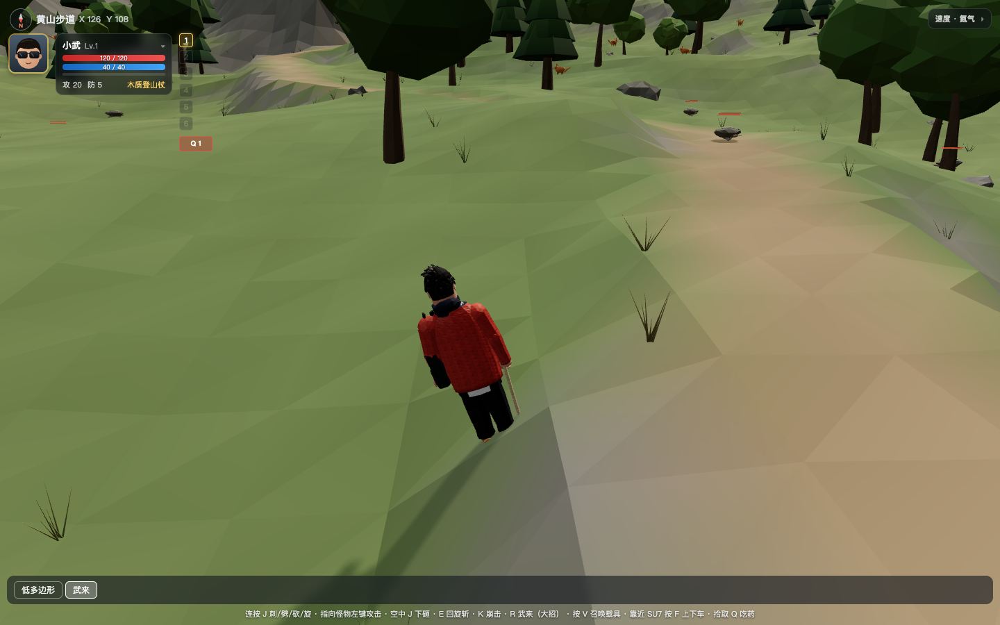
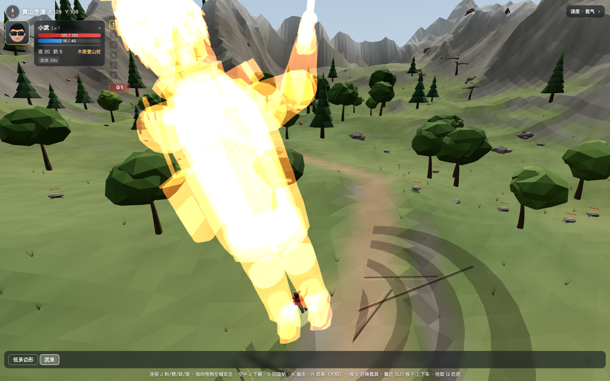
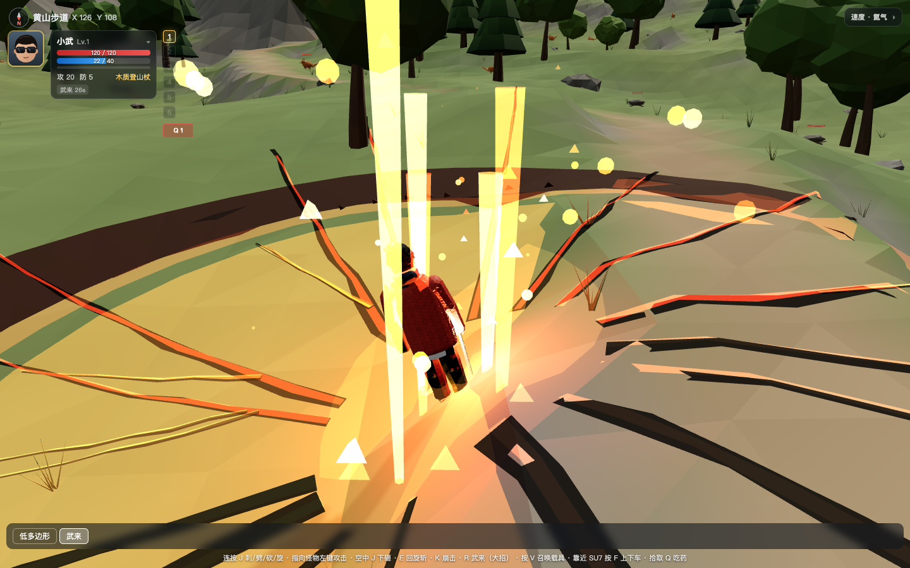
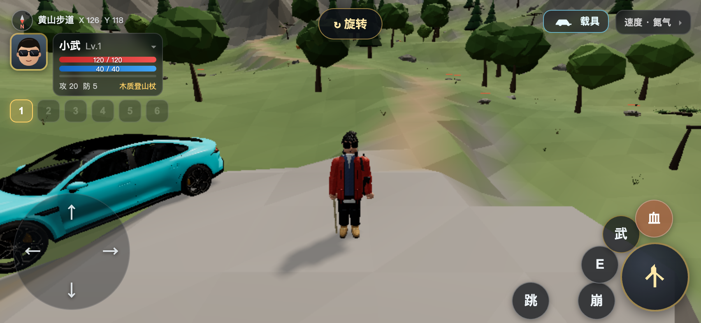

# 用 React Three Fiber 写了个浏览器里的 3D 动作游戏《武来》：黄山砍怪、放大招、开 SU7

> 在线体验：[https://arxun.github.io/wulai/](https://arxun.github.io/wulai/)（PC 和手机都能玩，手机建议横屏）

## 前言

《武来》是一个直接在浏览器里跑的低多边形 3D 动作游戏。主角叫小武，穿着红色冲锋衣、拄着登山杖走在黄山步道上，一路砍怪、升级、换武器。攒够了冷却就放大招"武来"，砸出一个冒岩浆的大坑。累了还能召唤一辆 SU7，开着车在山路上漂移、喷氮气。

整个游戏没有用任何游戏引擎，也几乎没有外部美术资源：人物、地形、树、石头、怪物、技能特效全部是代码现场生成的几何体，唯一的外部模型是那辆 SU7。技术栈就是前端同学熟悉的 React + Three.js。

这篇文章分两部分：先介绍游戏本身，再聊研发思路，重点是**性能和加载速度**，以及几个只在线上和真机才会暴露的坑。



## 一、游戏介绍

### 世界

- 地图是一片 260 米 × 260 米的黄山山谷。一条蜿蜒的步道从南到北穿过山谷，四周山脊环抱，西北角有一座主峰。
- 空气墙外还铺了一圈山坡，天际线上有远山，镜头贴着地图边缘也看不到"世界尽头"。
- 左上角有指北针和地图坐标（西南角为原点），方便找 Boss 和宝物。

### 战斗

- **连招**：连按 J 依次出"刺 → 劈 → 砍 → 旋"四段，空中按 J 是"下砸"。PC 上鼠标指向怪物会变成一把红色小剑，左键点怪和按 J 效果一样。
- **技能**：E 回旋斩（持续转 3 秒，四面都打）、K 崩击（高倍率重击）、R 大招"武来"。
- **大招"武来"**：3 秒的演出，冲击波最远打到 13 米，倍率 10 倍。落地后留下一个半径 6.5 米的岩浆坑，持续 5 秒，站在里面的怪会持续掉血。





### 成长

- 等级上限 99 级，升级会提升攻击、防御、血量和蓝量。
- 6 把武器：木质登山杖 → 玄铁短戟 → 霜华杖 → 赤焰矛 → 雷纹刀 → 血棘魔剑，攻击力从 10 涨到 156，数字键 1～6 切换。
- 地图上有 165 只小怪，分 5 种：青石蟹、雾狸、赤鸦、岩灵、山魈，越往高处越强。地图两个角各守着一只 Boss：东北角的玄甲天魁（4200 血）和东南角的赤鳞魇龙（4800 血）。
- 怪物按掉落表独立掷骰掉装备和回血丹，已经有的武器不会重复掉。西北角还藏着一把血棘魔剑。

### 载具

- 地图上停着一辆 SU7，靠近按 F 上车。PC 按 V、手机点"载具"按钮，可以把车直接召唤到身边。
- 开车时漂移会攒氮气：漂移满 20 米攒一瓶，最多存 3 瓶，每瓶喷 3 秒、速度翻 3 倍。

### 手机端

手机上是横屏布局：左下是方向盘，右下是普攻键，技能键绕着普攻键排成一道弧，双指捏合可以拉远拉近镜头。竖屏打开时，会把整个页面旋转 90° 横过来玩。



### 操作一览

| 操作 | PC | 手机 |
| --- | --- | --- |
| 移动 | WASD / 方向键 | 左下方向盘 |
| 普攻连招 | J，或鼠标点怪 | 右下剑形按钮 |
| 回旋斩 / 崩击 / 大招 | E / K / R | E / 崩 / 武 |
| 跳 | 空格 | 跳 |
| 吃回血丹 | Q | 血 |
| 上下车 / 召唤载具 | F / V | 上车 / 载具 |

## 二、技术栈

- React 18 + [React Three Fiber](https://github.com/pmndrs/react-three-fiber) v8 + drei v9 + three.js r168
- Vite 5 构建，Vitest 写单测
- GitHub Actions：推送 `main` 后自动构建，发布到 GitHub Pages

业务代码大约 1.5 万行 JS/JSX，提交记录集中在 10 月 28 日到 30 日这三天。

## 三、研发思路

### 1. 一切都是程序化生成的

不用美术资源，最大的好处是"改代码就是改美术"，而且包体非常小。

- **低多边形的风格底线**：有机形体（皮肤、五官、手）用平滑法线，人造物和植被（衣服、头发、岩石、树、地形）保持逐面的硬法线。再给每个三角面乘一点随机明暗，就有了"手工上色"的色块感。
- **放样建模**：身体、手指、嘴唇都是沿一条路径放样出来的连续曲面，形体细节写在截面的 profile 函数里，而不是堆一堆小球——堆球会留下接缝。
- **程序化贴图**：皮肤毛孔、布料纹理都用 canvas 现场画，贴图和顶点色相乘：顶点色决定色块，贴图只负责细节。

### 2. 主角是照着一张照片建出来的

小武的原型是一张黄山上拍的照片。建模时先把照片里的关键部位量成一张世界坐标锚点表（头顶 1.78 米、眼睛 1.598 米、下巴 1.435 米……），所有部位都对着这张表写。

骨骼没有用蒙皮，而是"几何体挪支点"：几何体仍然按世界坐标写，再整体平移到关节支点，放进一个可以旋转的 group。这样静止姿态和加骨骼之前**逐像素相同**，走跑动作只需要转 group。

两个细节：

- 姿态通过 ref 传给各部件，由部件自己的 `useFrame` 直接写 `rotation`，动画不会触发 React 重渲染。
- 步态相位按**走过的距离**推进（`phase += speed * dt / stride`），而不是按时间，这样脚永远不会在地上打滑；走和跑的参数按速度插值，不是两套独立动画。

### 3. 地形是一个纯函数

```js
export function terrainHeight(x, z) {
  const raw = baseHeight(x, z);            // 噪声起伏 + 环抱山脊 + 主峰
  const { dist, y } = nearestPath(x, z);    // 离步道多远、步道在这里多高
  // 步道附近压平到路面高程，并略微下切出车辙感
  ...
}
```

地面网格、植被散布、怪物刷新、玩家脚下的高度、车轮贴地，全都查这一个函数，所以人永远不会浮空，也不会陷进地里。

步道的高程是从原始地形取样后沿路平滑几遍得来的，最后再钳回原始地形附近，避免在山脊处挖出深沟、在洼地架起高堤。

### 4. 战斗是数值表驱动的

每个招式就是一行配置：

```js
stab: { name: '刺', time: 0.3, strike: [0.24, 0.7], mult: 1, range: 2.55, cone: 0.22, knock: 0.85 },
```

`cone` 是允许的朝向夹角余弦：1 只打正前方，0 打前方半圆，-1 四面都打。命中判定只认三件事：在不在出伤窗口、距离够不够、在不在扇形里。范围外必不中，范围内必中，手感非常确定。

### 5. 每帧变化的状态不放进 React

玩家位置、速度、漂移距离这些每帧都在变的数，放在模块级的单例对象里：控制器每帧写，HUD 每 50～100ms 读一次。场景里只有一个玩家，单例足够用，也不会因为每帧 `setState` 把 React 拖垮。

### 6. 渲染性能：让帧率稳住

这是花时间最多的部分。几个效果最明显的做法：

**光源数量永远不变。** three.js 里可见点光源的数量一变，所有受光材质都会重新编译着色器。最早放技能时特效自带点光源，第一次放技能会卡 2～3 秒。现在场景里常驻 4 盏点光源组成一个池子，特效只是"申请"光源，由池子按距离和亮度挑选，运行时光源数量始终是 4。

**着色器提前预热。** 进图后在浏览器空闲时，把技能、大招的特效根节点编译一遍，第一次放技能就不会卡。运行中也不切换会产生新着色器变体的材质属性（`transparent`、`vertexColors` 等），需要两种状态就提前建两份材质。

**重复物体一律合批。** 165 只怪物和大量技能粒子都用 `InstancedMesh`。多零件的怪物先把零件矩阵烘焙进一个几何体，再按材质参数分组合并。粒子的逐实例透明度单独用一个 `instanceAlpha` 属性，不乘进颜色里，因为有色调映射时两者结果不一样。

**点怪不做网格射线检测。** 鼠标指向怪物要判断有没有点中，如果对 165 只怪做网格 raycast 太贵。现在每只怪用一根竖直的胶囊体近似，射线和胶囊求交是几行解析计算，没有内存分配。

**逐帧逻辑不分配对象。** 所有怪物共用一个 `useFrame` 驱动，`useFrame` 里复用模块级的 `Vector3`、`Matrix4`。

为了不靠感觉判断，项目里内置了一个性能探针：访问 `?perf=auto` 会自动跑一遍连招、技能、大招、换武器、掉落，输出每一步的指标。验收标准是：

| 指标 | 要求 |
| --- | --- |
| 新编译的着色器 `newPrograms` | 每一步都是 0 |
| 点光源数量 | 始终是 4 |
| 最长帧时间 | 不超过约 20ms |
| draw call | 平时约 214，放大招约 660，不能高于基线 |

### 7. 首屏加载：移动端是底线

进图时主线程要先跑完所有同步构建（建地形网格、撒树、刷怪），才能画出第一帧，而手机比开发机慢 4～6 倍。

- **先给反馈**：HTML 里直接写一个加载遮罩，JS 还没下载完就能看到进度。
- **移动端降精度**：地形网格分段 176 → 120，阴影贴图 1024 → 512，像素比固定为 1，草丛数量 880 → 520。这个开关要在第一次构建前就设好，否则会先按桌面精度建一遍。
- **算过的不再算**：地形着色要用到坡度，原来每个顶点额外算两次高度，现在直接查相邻顶点已经算好的高度。
- **第一帧用不到的都往后放**：SU7 和环境光拆成单独的包，第一帧画出来之后，在浏览器空闲时按批次挂上。车的资源用低优先级的 `prefetch` 拉，不和首屏脚本抢连接。
- **画面出来就进**：遮罩在主场景画出第一帧时就关，不等 SU7，也不等技能预热。
- **同步构建有预算**：按移动端参数实测，现在进图时的同步计算合计约 110ms（开发机上）。新功能每项加进去的同步耗时不超过约 20ms，超了就降精度或挪到进图之后。

### 8. 移动端适配

- **整页旋转**：竖屏时把整个页面用 CSS 旋转 90°，触点坐标再按旋转角度换算回来，方向盘和镜头拖动才不会反。
- **安全区跟着旋转换边**：iPhone 横屏时左右有灵动岛和圆角。页面旋转 90° 后，物理屏幕的上下边变成了画面的左右边，所以每个旋转角度要映射不同的 `env(safe-area-inset-*)`。
- **双指捏合调镜头**，同时拦住浏览器自己的页面缩放。

## 四、踩过的坑

### 坑 1：开发环境好好的，线上报 `Cannot access 'Ya' before initialization`

为了拆包，我在 `vite.config.js` 的 `manualChunks` 里按目录把业务代码分成了 `game` 和 `lowpoly` 两个包。但人物模型放在 `lowpoly` 目录里，又依赖游戏的战斗状态；游戏也反过来依赖人物模型，两个包就形成了循环引用。

开发环境按模块逐个加载，不会有问题；生产包里两个 chunk 互相 import，执行顺序错了，一个模块用到了另一个还没初始化的变量。构建日志里其实一直有一行 `Circular chunk: lowpoly -> game -> lowpoly` 的警告，是我没当回事。

解决：`manualChunks` 只给 `node_modules` 里的第三方库分包（three、r3f、drei 不会反过来引用业务代码），业务代码交给 `lazy(() => import(...))` 让 Rollup 自动拆。

**教训**：动了 import 结构或打包配置，必须构建生产包、在预览服务里打开看控制台；`Circular chunk` 警告一律当错误处理。

### 坑 2：手机上卡在加载页进不去

外层有一个移动端的旋转外壳是懒加载的，我给它的 `Suspense` 写了 `fallback={body}`——外壳没到之前，先渲染一份不带外壳的正文。问题是正文里就有整个游戏画布：手机会先完整建一遍场景和 WebGL 上下文，外壳到了再拆掉重建一遍。地形变复杂之后，手机直接卡死在第一次构建里。

解决：`fallback` 改成 `null`，等待期间由加载遮罩盖住，场景只建一次。

**教训**：`Suspense` 的 `fallback` 里绝不能放画布或和正文同一棵重量级子树。

### 坑 3：iPhone 横屏时方向键和技能键"消失"了

旋转外壳的宽高原来是在 `resize` 事件里读 `visualViewport` 算出来的像素。iOS 转屏时，`resize` 事件先到、尺寸后变，读到的高度可能还是竖屏的值。外壳比屏幕高出一大截，贴底部的方向键和技能键全被挤到屏幕外面，画面和顶部 HUD 却一切正常，非常迷惑。

解决：不需要旋转时，外壳直接用 CSS 的 `100%` 铺满；需要旋转时，用 `ResizeObserver` 量页面容器的实际尺寸——它在布局真正变化之后才触发，不会读到旧值。

**教训**：排版尺寸不要信任 `resize` 事件里读到的视口，也不要用 `100vh`（iOS 上它比可见区域高）。

### 坑 4：小米手机长按方向键会弹出系统识图

小米的识图、iOS 的放大镜、浏览器的长按菜单，都是从页面没有取消的 `touchstart` 长按触发的。按钮在 `pointerdown` 里调 `preventDefault` 拦不住它们。

解决：对需要按住的操控区（方向盘、攻击和技能键、画布）统一取消 `touchstart`。但用 `onClick` 的按钮（武器栏、载具按钮）不能这么做：`touchstart` 被取消后浏览器就不会再派发 `click`，按钮会点不动。所以按住类按钮全部改用 `pointerdown` / `pointerup`。

### 坑 5：车开起来轮子不转

SU7 模型压缩时用了 `gltf-transform optimize`，它会把节点层级拍平，车轮这种需要单独旋转的子节点就没了。后来只用 Draco 压缩（`gltf-transform draco`），保留节点层级。另外 GLTFLoader 会清洗节点名（`Wheel.001` 变成 `Wheel001`），按名字找节点时正则要兼容两种写法。

## 五、和 AI 一起开发

这个项目是我和 Cursor 的 Agent 一起写的。实际体验下来，让 AI 写代码不难，难的是让它**不重复犯错**。我的做法是把每次踩坑的结论沉淀成项目规则（`.cursor/rules/*.mdc`）和技能文档（`.cursor/skills/`）：

- `perf-first.mdc`：每次对话都生效。写明"渲染效率和加载速度优先、改动不能引入 bug"，以及上面坑 1、坑 2 的硬约束。
- `wulai-perf-standards/SKILL.md`：光源池、着色器预热、合批、首屏预算、打包和验收流程的具体做法，改相关代码前先读。
- `mobile-controls.mdc`：改移动端文件时自动生效，记录长按拦截、横竖屏尺寸、安全区和真机验收方法。
- `person-model.mdc`：人物的锚点表、骨骼正负号约定和已经踩过的建模坑。

每修一个 bug，就问一句"这个错怎么才能以后不再犯"，然后把答案写进规则。规则越攒越多，AI 改代码时越来越少碰到同样的坑。验收也尽量自动化：无头 Chrome + CDP 模拟手机横竖屏、安全区、真实触摸，配合性能探针看指标，而不是靠肉眼"看起来没问题"。

不过有些问题模拟器复现不了，比如 iOS 转屏时的视口滞后、小米的系统识图，最后还是要真机确认。

## 结语

用前端熟悉的 React + Three.js 做一个能玩的 3D 动作游戏，比想象中可行。真正的难点不在"画出来"，而在"在手机上也又快又稳"：光源、着色器、draw call、首屏同步计算，每一项都要有数字、有预算。

欢迎来玩：[https://arxun.github.io/wulai/](https://arxun.github.io/wulai/)，有问题或建议欢迎评论区交流。
